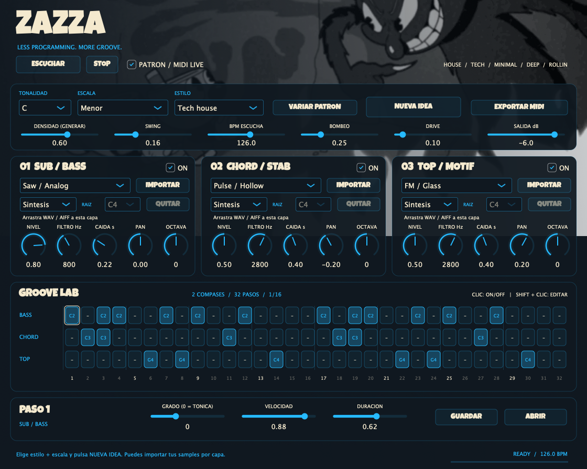

# Zazza

Instrumento **VST3** para construir grooves de house, tech house, minimal, deep house y rollin. Combina **tres capas de sonido** —bajo, acordes y motivo agudo— usando síntesis interna o tus samples WAV/AIFF. La versión **1.1.0** genera patrones relacionados entre sí, elige timbres y ajusta su mezcla con un botón. Incluye aplicación standalone para escuchar sin abrir un DAW.



Estética basada en FindNote: Luckiest Guy, crema y azul neón `#26BAFF`. El fondo `assets/wallpaper.gif` es una copia del archivo `190588.gif` proporcionado por el usuario y se integra en el binario. La interfaz muestra **el primer fotograma**, sin animación.

## Crear un groove

1. Carga **Zazza** en una pista de instrumento o abre la aplicación standalone y configura su salida de audio.
2. Elige **tonalidad**, **escala** y **estilo**. Si quieres usar tus sonidos, pulsa **Importar** en una capa o arrastra allí un WAV/AIFF; ajusta **Raíz** a su nota original.
3. Pulsa **Nueva idea**: crea patrones coordinados, timbres internos y una mezcla inicial. Conserva tus samples, su nota raíz, la tonalidad, las capas apagadas, el tempo y la salida.
4. Pulsa **Escuchar**, o inicia el transporte del DAW con **Patrón** activado. No suena automáticamente al cargarlo.
5. Ajusta **Densidad** y pulsa **Nueva idea** para otra combinación. Si te gustan los sonidos actuales, usa **Variar patrón**: cambia las notas y el ritmo conservando sonidos, filtros, niveles y swing. Densidad y Estilo seleccionan cómo se genera la siguiente idea; no regeneran al moverlos. La tonalidad y escala sí se aplican inmediatamente.
6. Mezcla las capas, ajusta su filtro y caída, o apaga las que no necesites.
7. Haz clic en una celda para activar/desactivar una nota. **Shift + clic** la selecciona sin cambiarla. Abajo puedes modificar grado, velocidad y duración.
8. Guarda el preset o exporta un MIDI para seguir trabajando en tu DAW.

**Stop** apaga la escucha, desactiva el secuenciador y libera las notas. Vuelve a activar **Patrón** para seguir al transporte. La casilla desactivada permite tocar las tres capas desde la entrada MIDI del DAW; conserva las notas originales, sin ajustarlas a la escala.

## Música y síntesis

| Control | Función |
| --- | --- |
| Tonalidad | Las 12 notas cromáticas, con nombres C, C#, D, etc. |
| Escala | Menor natural, dórica, mayor o pentatónica menor |
| Patrón | 32 pasos de semicorchea; loop fijo de 8 negras, equivalente a dos compases de 4/4 |
| Grado | 0 = tónica; +1 = siguiente nota de la escala; valores negativos descienden dentro de la escala |
| Bajo | Una nota por paso; base C2 = MIDI 36 |
| Acordes | Cuatro notas por paso, separadas por dos grados de la escala; base C3 = MIDI 48 |
| Top | Una nota por paso; base C4 = MIDI 60 |
| Octava | Desplaza cada capa entre −2 y +2 octavas en el patrón y MIDI exportado |
| Swing | Retrasa las semicorcheas alternas, de 0 a 0.60 |
| Duración | Gate de cada paso; se acorta con swing para evitar solapamientos |
| Fuente / Raíz | Síntesis interna o sample propio; Raíz indica la nota original del sample (C4 = MIDI 60) |
| Síntesis | Seno/sub, saw analógico, pulse o FM glass, seleccionables por capa |
| Filtro / Caída | Filtro paso bajo y caída de envolvente por capa |
| Bombeo | Atenuación rítmica en cada negra; no necesita sidechain externo |
| Drive / Salida | Saturación suave y nivel final en dB |

La generación es reproducible con la misma semilla, estilo y densidad. Tanto **Nueva idea** como **Variar patrón** eligen otra semilla. Bajo, acordes y melodía comparten la armonía de cada compás; la melodía utiliza notas del acorde y evita los ataques de las otras capas. El segundo compás repite el motivo rítmico con una respuesta armónica/melódica. Nueva idea elige entre paletas de timbres y ajusta filtros, caída, niveles, panorama, swing, bombeo y drive: bajo centrado, acordes y top separados en estéreo. Son reglas musicales locales, sin servicios de IA ni conexión a internet durante el uso. No es una garantía subjetiva de calidad ni un mezclador que analice espectralmente cualquier grabación.

Si un registro extremo sale del rango MIDI, la nota se traslada por octavas hasta entrar en 0–127, conservando su pertenencia a la escala.

Los acordes se forman dentro de la escala seleccionada. En pentatónica producen voicings pentatónicos; no se describen como acordes de séptima diatónicos. La convención de notas es científica: C4 = MIDI 60, A4 = 440 Hz. Cada capa dispone de 12 voces, con ataque breve y liberación de 18 ms; saw y pulse usan PolyBLEP. La mezcla suaviza nivel, filtro, panorama y salida. No es un emulador de un sintetizador comercial.

## Tus samples

- Importa o arrastra un **WAV/AIFF**, mono o estéreo, de **hasta 8 segundos y 8 MiB**, entre 8 y 192 kHz. Hay un sample por capa y se pueden combinar samples con sintetizadores internos.
- Usa preferentemente **una nota individual o one-shot**, sin silencio al comienzo. En la capa de acordes se disparan cuatro notas del sample; una grabación que ya contiene un acorde se apilaría cuatro veces y puede resultar disonante.
- Indica la nota original en **Raíz**. Por ejemplo, si grabaste un La3, selecciona A3. La afinación se hace a partir de ese valor; **no se detecta automáticamente**.
- La transposición cambia la velocidad de reproducción y su duración, como en un sampler básico. No hay time-stretch, detección de BPM, recorte de loops ni extracción de notas de una canción. Las muestras no se repiten en bucle; las controla la envolvente y el gate del paso.
- Los filtros, caída, nivel y panorama también afectan a las muestras. Para reservar margen al superponer voces, los picos por encima de 0.8 se atenúan al decodificar; no se amplifican grabaciones débiles ni se modifica el archivo original.
- **Nueva idea conserva tu sample y su raíz**. **Variar patrón** conserva además toda la mezcla. **Quitar** vuelve a síntesis sin borrar el archivo de tu disco. Elegir Sample sin cargar uno produce silencio en esa capa.
- Los archivos se leen y decodifican fuera del callback de audio. Cambiar un sample reinicia las voces; puede interrumpir brevemente las notas que están sonando.

## Sincronización y otros sintetizadores

Con el DAW reproduciendo se usan su tempo y posición PPQ. **BPM escucha** solo controla la preescucha y el standalone; generar ideas no cambia el tempo del proyecto ni el de escucha. Las posiciones negativas, saltos y loops del host se admiten. La cuadrícula es fija de 8 negras: en otros compases no representa necesariamente dos barras del host. Si el host no proporciona PPQ, el reloj avanza desde la posición interna a su tempo disponible.

Cada capa mezcla síntesis integrada o un sample propio. No aloja plugins VST3 externos. También puedes usar otros instrumentos del DAW mediante MIDI:

- **Exportar MIDI** crea un archivo tipo 1, a 960 ticks por negra, con pista de tempo y tres pistas de notas. Las capas apagadas no exportan notas. El archivo conserva swing, duración, velocidad, tonalidad y octava, con longitud exacta de ocho negras.
- Importa el archivo en el DAW y asigna cada pista a tu sintetizador. El nombre de archivo se elige en un diálogo de guardado; no se necesita una ruta fija.
- También se emiten notas en vivo: bajo por canal MIDI 1, acordes por 2 y top por 3. El DAW debe admitir el enrutamiento de salida MIDI de un instrumento VST3. Si no lo ofrece, usa el archivo MIDI.

En modo MIDI live se reciben note-on, note-off y all-notes/sound-off; no hay pedal sustain ni pitch bend. La octava de capa y la selección de escala solo modifican el secuenciador. No se cuantizan las notas tocadas. El plugin declara latencia cero y una cola de liberación de 0.25 s. El transporte, las notas MIDI sostenidas y el botón Escuchar no se guardan en los presets: cargar una sesión no inicia una preescucha accidental.

## Sesiones y presets

Todos los controles y cada paso se exponen como parámetros y se guardan con la sesión del DAW. **Guardar / Abrir** permiten compartir presets `.zazza`, con el mismo estado y semilla. El formato tiene versión y valida parámetros y audio antes de cargar. Los samples se incluyen dentro del preset y del estado del DAW: no dependen de la ruta original. Los archivos malformados no reemplazan el preset actual. El estado completo admite hasta 40 MiB; guardar tres muestras puede producir presets de varios megabytes.

El contrato del esquema 1 conserva los 416 IDs originales. Las futuras adiciones de parámetros conocidos reciben sus valores de fábrica si faltan en un preset antiguo; no heredan el estado de otra sesión. Se siguen rechazando estados incompletos de la versión 1, IDs desconocidos, duplicados y valores inválidos. La versión 1.1 usa el esquema 2 para almacenar las muestras y sigue leyendo sesiones del esquema 1; los nuevos parámetros de fuente/raíz toman sus valores de fábrica. Una sesión 1.1 no se puede abrir en el plugin 1.0. Cambios incompatibles de significado requieren una migración explícita.

## Compilar localmente

Requisitos comunes: Python 3, Git, CMake ≥ 3.22 y conexión a internet para descargar JUCE en el primer build. La revisión está fijada al commit `dabd5ad13cd869cba41046947fffc8e5ce5cd662`. No hace falta descargar el SDK VST3 por separado. Los scripts no instalan plugins en el sistema.

**macOS:** Xcode con herramientas de desarrollo. Desde la raíz del repositorio, Apple Silicon:

```bash
python3 scripts/build.py --arch arm64 --pluginval --package
```

Intel, desde la misma raíz, con un Mac Intel o Rosetta disponible para ejecutar las pruebas Intel:

```bash
python3 scripts/build.py --arch x86_64 --build-dir build-intel --pluginval --package
```

**Windows x64:** Visual Studio 2022 con Desktop development with C++, Windows SDK, Python y CMake en PATH. Desde la raíz en PowerShell:

```powershell
python scripts/build.py --arch x86_64 --build-dir build-windows --pluginval --package
```

El script configura, compila Release, ejecuta CTest, verifica el manifiesto VST3 y empaqueta VST3 + standalone. En macOS comprueba arquitectura, versión y firma ad hoc. Los resultados quedan en `build/Zazza_artefacts/Release/` y `dist/`. Cada ZIP tiene SHA-256 y metadatos. No se sobrescriben paquetes existentes; usa otra carpeta con `--dist-dir dist/otra-validacion`.

Con `--pluginval`, descarga el validador 1.0.4 desde su release oficial, verifica el SHA-256 fijado para macOS/Windows y exige nivel 5 **incluidas las pruebas de GUI** antes de empaquetar. Un error, timeout o ausencia del marcador final `SUCCESS` detiene el proceso. Los registros se guardan en `validation/`. En macOS se ejecuta explícitamente la arquitectura elegida; Intel desde Apple Silicon requiere Rosetta. Puedes omitir ese flag en builds locales, en cuyo caso los metadatos no declaran una validación con pluginval.

Puedes proporcionar `--cmake /ruta/absoluta/a/cmake` si no está en PATH. `--juce-source /ruta/al/checkout/JUCE` permite reutilizar una copia local; el script comprueba que su HEAD coincide con la revisión fijada. No depende de `../findnote` para compilar un clon nuevo.

Solo motor y pruebas musicales, desde la raíz con CMake y compilador C++17; no descarga JUCE:

```bash
cmake -S . -B build-core -DZAZZA_BUILD_PLUGIN=OFF -DCMAKE_BUILD_TYPE=Release
cmake --build build-core --config Release --parallel 3
ctest --test-dir build-core -C Release --output-on-failure
```

## GitHub Actions

El workflow [build.yml](.github/workflows/build.yml) se ejecuta en pushes a `main`/`master`, pull requests y manualmente. Usa **semantic-release**, siguiendo el flujo de FindNote: comprobar → calcular versión → compilar las tres plataformas → verificar paquetes → publicar. Solo los pushes a `main` con cambios publicables crean el tag y la GitHub Release. No crea commits de versión ni publica en npm. PR, `master` y ejecuciones manuales generan paquetes de comprobación `0.0.0`, sin publicación.

Los jobs instalan **Python 3.12** con [setup-python 7.1.0](https://github.com/actions/setup-python/releases/tag/v7.1.0), fijado por SHA. Cada job nativo ejecuta las pruebas Python, compila, ejecuta CTest y valida con [pluginval 1.0.4](https://github.com/Tracktion/pluginval/releases/tag/v1.0.4) antes de crear paquetes. Los logs se conservan también cuando falla una validación; los paquetes solo se suben si todo pasó.

| Runner | Artefacto |
| --- | --- |
| Ubuntu 24.04 | Pruebas del motor C++ portátil |
| macOS 15 arm64 | ZIP de VST3 + standalone Apple Silicon |
| macOS 15 Intel | ZIP de VST3 + standalone Intel |
| Windows 2022 x64 | ZIP de VST3 + standalone Windows x64 |

Los artefactos de Actions se conservan 14 días. Cada uno incluye ZIP, checksum y JSON con commit, versión, plataforma, revisión de JUCE y resultado de pluginval. Las releases publicadas adjuntan los tres ZIP nativos y sus checksums. Antes de crear el tag, `scripts/verify-release.mjs` exige las tres plataformas, la versión calculada, el commit de esa ejecución, VST3 + standalone, pluginval nivel 5 con GUI y hashes correctos. Si una compilación, validación o verificación falla, no se publica.

La versión se calcula con Conventional Commits: `fix:` y `perf:` incrementan el parche; `feat:` la versión menor; `feat!:` o un pie `BREAKING CHANGE:` la mayor. `docs:` y `ci:` por sí solos no crean releases después de una release existente. **Sin tags previos, la primera release será `v1.0.0`**; la versión local histórica `1.1.0` no es un tag de publicación. Los commits existentes `feat: zazza synths random` y `fix: missing file` sí son reconocidos. No se ha creado un tag de base ni publicado una release al preparar esta integración.

El planificador hace un dry-run y pasa la versión a `scripts/build.py --version`, que la transmite a CMake como `ZAZZA_VERSION`. El manifiesto generado debe coincidir antes de firmar o empaquetar. En compilaciones locales sin esa opción se conserva el valor predeterminado `1.1.0`. La release se publica en la misma ejecución que construyó los binarios; no depende de que un tag generado por `GITHUB_TOKEN` dispare otro workflow.

Los jobs de compilación tienen permisos de lectura. Solo planificación y publicación solicitan `contents: write`, y ambos se limitan a pushes a `main`. El dry-run necesita ese permiso porque semantic-release comprueba acceso de push aunque no publique ([documentación oficial](https://semantic-release.org/usage/configuration/#dryrun)). Se usa el `GITHUB_TOKEN` de Actions, sin PAT adicional. Node 24 se configura mediante `.nvmrc`; las dependencias de release están fijadas en `package-lock.json` y las actions por SHA.

Se conserva la firma y notarización macOS existente para los paquetes que van a publicarse. Requiere los secrets `MACOS_DEVELOPER_ID_P12_BASE64`, `MACOS_DEVELOPER_ID_P12_PASSWORD`, `ASC_KEY_ID`, `ASC_ISSUER_ID` y `ASC_KEY_P8`. Si faltan o fallan, la release falla en lugar de publicar esos paquetes sin firmar. Las ejecuciones de comprobación usan firma ad hoc. Las releases concurrentes de la misma rama no cancelan una publicación que ya esté en curso.

Para subir el proyecto, conserva `Source/`, `Tests/`, `assets/`, `scripts/`, `docs/`, `.github/`, `.gitignore`, `.nvmrc`, `CMakeLists.txt`, `LICENSE`, `package.json`, `package-lock.json`, `release.config.cjs`, este README y `THIRD_PARTY_NOTICES.md`. Los builds, paquetes, cachés, `node_modules` y archivos de coordinación están excluidos.

Para verificar el tooling de release sin publicar, desde la raíz y con Node 24.10 o posterior:

```bash
npm ci --ignore-scripts
npm run test:release
```

También puedes generar un ZIP de fuentes desde la raíz, con Python 3 y sin un ZIP previo en el destino. Incluye `.github/` y los recursos, y excluye builds, herramientas, cachés y datos locales mediante una lista explícita:

```bash
python3 scripts/package_source.py --output dist/Zazza-source.zip
```

## Instalación

Descomprime el paquete de tu arquitectura y copia **la carpeta completa** `VST3/Zazza.vst3`:

| Sistema | Destino |
| --- | --- |
| macOS | `~/Library/Audio/Plug-Ins/VST3/` |
| Windows | `C:\Program Files\Common Files\VST3\` |

Luego vuelve a escanear VST3 desde tu DAW. La app standalone está en `Standalone/`. No se incluye AU, AAX ni VST2. Los paquetes locales y de comprobación tienen firma ad hoc; el workflow de release exige firma Developer ID y notarización en macOS.

## Validación y límites

Las pruebas cubren generación determinista, pertenencia a escalas, swing, límites de gate, liberación de voces, síntesis a 44.1/48/96/192 kHz, integración MIDI a varios tamaños de bloque, equivalencia entre exportación y reproducción, transporte, preescucha, entrada MIDI, persistencia, migración aditiva de estados, estados inválidos, mute y salida mono. Las pruebas Python comprueban además el bloqueo del empaquetado cuando falla el validador, sus timeouts, los hashes y los comandos de ambas plataformas; simular Windows no sustituye ejecutar sus binarios en Windows.

El resultado local de la compilación y las comprobaciones ejecutadas se registra en [docs/VALIDATION.md](docs/VALIDATION.md). Una compilación local no demuestra ejecución en Windows ni validación real en un DAW. El usuario aclaró que necesita generar arreglos con distintos sonidos, incluidos samples propios; ese flujo está implementado. No incluye hosting de plugins externos. Las pruebas de importación utilizan señales sintéticas WAV/AIFF; todavía falta escuchar tus muestras y ajustar su raíz en tu DAW.

El archivo [LICENSE](LICENSE) presente en el proyecto contiene AGPLv3 y se incluye sin modificaciones en los paquetes. Los derechos de redistribución del wallpaper siguen pendientes de confirmación del autor. Consulta [THIRD_PARTY_NOTICES.md](THIRD_PARTY_NOTICES.md) antes de publicar. JUCE ofrece [AGPLv3 o licencia comercial](https://github.com/juce-framework/JUCE/blob/dabd5ad13cd869cba41046947fffc8e5ce5cd662/LICENSE.md); los avisos de Luckiest Guy se incluyen en los paquetes.
